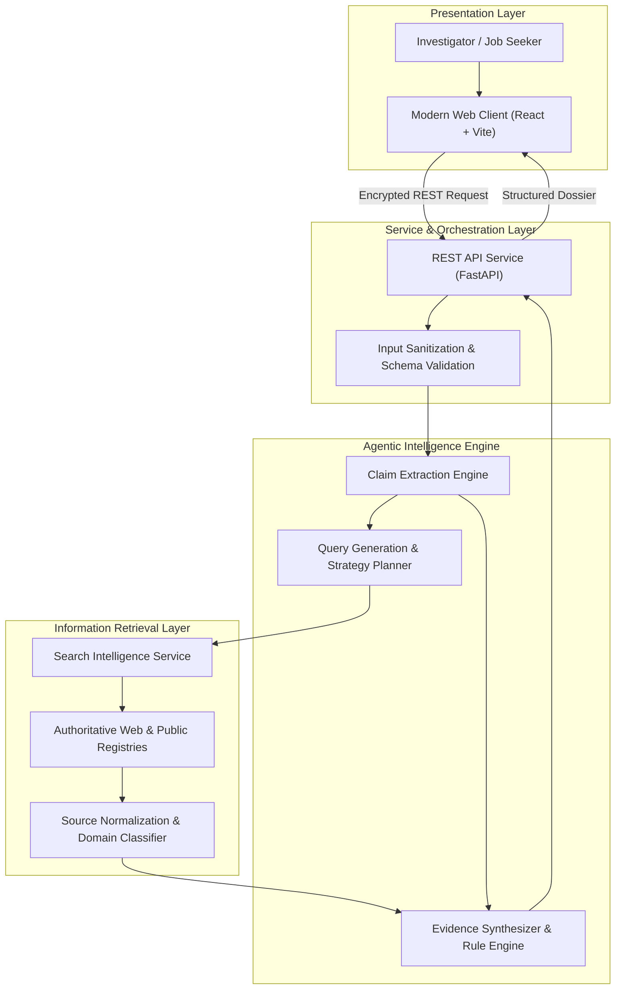
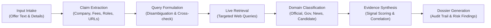
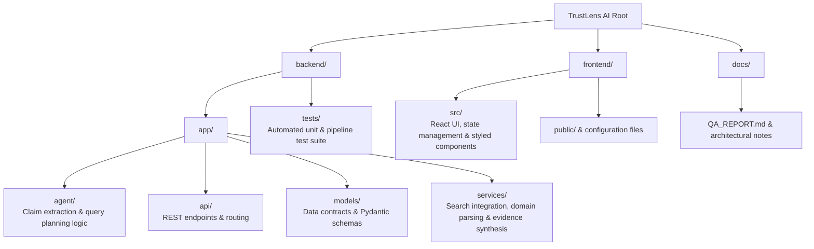

# TrustLens AI

[](https://fastapi.tiangolo.com)
[](https://react.dev)
[](https://vitejs.dev)
[](https://docs.pydantic.dev)
[](LICENSE)

TrustLens AI is an open, evidence-driven verification platform designed to investigate suspicious recruitment communications, unsolicited job offers, and impersonation attempts. Rather than functioning as a black-box detector, TrustLens AI operates as an investigative copilot: it decomposes recruiter correspondence into discrete, verifiable claims, formulates targeted validation queries against public web sources, classifies citation authenticity, and constructs an auditable, transparent evidence dossier for human evaluation.

---

## System Architecture



---

## Investigation Pipeline

TrustLens AI follows a disciplined multi-stage verification pipeline to ensure every finding is backed by traceable evidence:



1. **Intake & Validation:** Receives unstructured message text, declared company identities, recruiter contact info, and application links. Validates payloads against strict schema constraints and sanitizes inputs.
2. **Claim Extraction:** Parses text into factual checkable assertions (e.g., entity existence, payment requests, registration fees, recruiter identity claims, application portals).
3. **Targeted Query Planning:** Formulates objective search queries designed to corroborate or refute each extracted claim without confirmation bias.
4. **Information Retrieval:** Gathers current public web results across authoritative directories and search indexes.
5. **Domain Normalization & Classification:** Categorizes discovered sources into high-fidelity buckets (`official`, `government`, `professional_network`, `job_board`, `news`, `official_candidate`, or `other`).
6. **Evidence Cross-Referencing:** Evaluates findings against known recruitment risk indicators (such as advance-fee demands, disposable contact domains, and domain impersonation).
7. **Transparent Audit Dossier:** Compiles an end-to-end audit trail including every query executed, sources consulted, confidence ratings, and actionable guidance.

---

## Repository Structure



---

## Core Capabilities

- **Factual Decomposition:** Automatically isolates critical recruitment assertions, highlighting red flags such as advance payments or non-corporate contact points.
- **Conservative Source Classification:** Distinguishes verified corporate domains and government registries from general search candidates.
- **Zero Hallucination Assurance:** Every assertion presented to the user is anchored in recorded search queries and retrievable web snippets.
- **Degradation Handling:** Gracefully reports incomplete or missing web evidence rather than assuming malicious intent when external data is sparse.
- **Audit-First Philosophy:** Delivers an explicit chronological trail of each agentic decision for manual review by employment security analysts.

---

## Getting Started

### Prerequisites

- **Python:** 3.10 or newer
- **Node.js:** Current LTS recommended
- **Package Managers:** `pip` / `uv` for Python, `npm` for Node.js
- **API Credentials:** SerpApi key (for live web search; automated test suites operate with self-contained test mocks)

---

### Environment Setup

Create an environment configuration file from the provided template:

```bash
cd backend
cp .env.example .env
```

Define your search credentials inside `backend/.env`:

```env
SERPAPI_API_KEY=<your_api_key_here>
```

> [!IMPORTANT]
> Never commit active `.env` files or operational secrets into version control. Standard repository rules explicitly ignore local environment files.

---

### Starting the Backend Service

1. Navigate to the backend directory and set up an isolated environment:

   ```bash
   cd backend
   python -m venv .venv
   ```

2. Activate your virtual environment:
   - **Windows (PowerShell):** `.\.venv\Scripts\Activate.ps1`
   - **macOS / Linux:** `source .venv/bin/activate`
3. Install dependencies:

   ```bash
   python -m pip install -r requirements-dev.txt
   ```

4. Launch the application service:

   ```bash
   python -m uvicorn app.main:app --reload
   ```

Interactive API documentation will be available at your server's `/docs` endpoint.

---

### Starting the Frontend Client

In a separate terminal session:

1. Navigate to the frontend workspace:

   ```bash
   cd frontend
   ```

2. Install dependencies:

   ```bash
   npm install
   ```

3. Launch the development server:

   ```bash
   npm run dev
   ```

The client application includes an integrated reverse proxy that automatically forwards `/api` endpoints to your active backend service.

---

## API Specification

### Health Check

Verifies backend operational status.

```http
GET /api/health
```

**Response:**

```json
{
  "status": "ok",
  "service": "TrustLens AI"
}
```

---

### Investigate Offer

Executes the end-to-end claim extraction, search retrieval, and evidence synthesis pipeline.

```http
POST /api/investigate
Content-Type: application/json
```

**Request Payload:**

```json
{
  "company_name": "Acme Technologies",
  "message_text": "Congratulations! You have been accepted for a remote position. A refundable onboarding fee is required for equipment dispatch.",
  "application_url": "https://careers.acme-sample.org/apply",
  "recruiter_details": {
    "name": "Jane Recruiter",
    "email": "jane@acme-sample.org",
    "phone": "+1-555-0199"
  }
}
```

**Response Overview:**

```json
{
  "investigation_id": "inv_8f7b2c",
  "overall_finding": {
    "status": "high_risk",
    "summary": "Advance fee requested; non-official domain detected."
  },
  "claims": [...],
  "search_queries": [...],
  "sources": [...],
  "evidence": [...],
  "findings": [...],
  "investigation_trail": [...],
  "explanation": "Detailed plain-language analysis linking claims to corroborating or refuting sources."
}
```

---

## Automated Testing & Quality Assurance

The test suite validates claim extraction, query synthesis, source classification, and investigation orchestration using deterministic mocks:

```bash
cd backend
python -m pytest -q
```

Refer to [`docs/QA_REPORT.md`](docs/QA_REPORT.md) for complete details on verified scenarios and regression safeguards.

---

## Safety, Limitations & Operational Boundaries

- **Decision-Support Focus:** TrustLens AI provides investigative context and indicators. It does not replace independent human discretion or legal consultation.
- **Candidate Domains vs. Verified Owners:** Algorithmic domain matching flags resemblance candidates; definitive corporate ownership must be corroborated through official corporate registries.
- **Dynamic Content Constraints:** Search snippet indexing may experience latency or incompleteness relative to newly registered phishing vectors.
- **Defensive Posture:** External search timeouts and lookup failures are explicitly surfaced as incomplete verification points rather than assumed confirmation of maliciousness.
